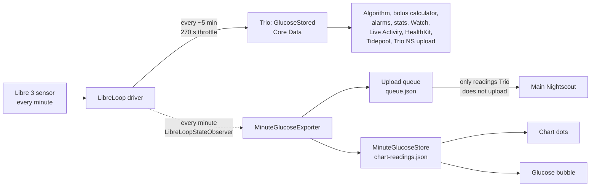

# Libre 3 minute readings in Trio – test branch `libre-1min-display`

Fork: **DIAforMary/Trio** · Test branch: **`libre-1min-display`** · Base: **nightscout/Trio `main`**

> **Status: personal test version, not an upstream contribution.**
> The code in this branch was written with Claude (AI) and is marked as such in every
> commit (author "Claude", `Co-Authored-By` line). It is not meant for a pull request to
> nightscout/Trio, whose contribution guidelines exclude largely AI-generated code. Its
> purpose is to try minute readings in real life and to collect experience for the
> discussion in feature request [#1728](https://github.com/nightscout/Trio/issues/1728)
> and on the Trio Discord.

---

## Contents

1. [What the test branch does, in short](#1-what-the-test-branch-does-in-short)
2. [Branches and app versions](#2-branches-and-app-versions)
3. [The features in detail](#3-the-features-in-detail)
4. [How it works internally](#4-how-it-works-internally)
5. [What it does not touch (safety)](#5-what-it-does-not-touch-safety)
6. [Settings reference](#6-settings-reference)
7. [Effects on Nightscout and follower apps](#7-effects-on-nightscout-and-follower-apps)
8. [Building: first build and after Trio updates](#8-building-first-build-and-after-trio-updates)
9. [Installing and switching versions in TestFlight](#9-installing-and-switching-versions-in-testflight)
10. [Using the test branch for documentation](#10-using-the-test-branch-for-documentation)
11. [Troubleshooting](#11-troubleshooting)
12. [Limits and differences to the maintainers' proposal](#12-limits-and-differences-to-the-maintainers-proposal)
13. [Technical reference](#13-technical-reference)
14. [Change history](#14-change-history)

---

## 1. What the test branch does, in short

The FreeStyle Libre 3 / 3+ sensor measures every minute. Trio's Libre 3 driver
(LibreLoop) receives every one of these readings, but passes only about every fifth one
(≥ 270 s apart) on to Trio. Trio stores, calculates with, displays and uploads only those
5-minute readings.

The test branch makes the four readings in between usable **for display and upload
only**:

| Feature | What you get | Default |
|---|---|---|
| **Upload to main Nightscout** (experimental) | The in-between minute readings are added to your main Nightscout, so Nightscout shows a reading every minute | Off |
| **Chart dots** | Small faded dots for the minute readings behind the normal 5-minute dots on Trio's home screen chart | Off |
| **Glucose bubble** | Optionally a small line with the newest minute reading, or the minute reading as the big number | Off ("5-minute value only") |

The algorithm, the bolus calculator, alarms, statistics, Apple Watch, Live Activity,
HealthKit, Tidepool and Trio's own Nightscout upload **keep using only the 5-minute
readings**, exactly as in original Trio. With all options off, the app behaves like
original Trio.

---

## 2. Branches and app versions

| Branch | Content | Built how |
|---|---|---|
| `main` | Unchanged nightscout/Trio | Automatically every Sunday (scheduled build), synced from nightscout/Trio first |
| `libre-1min-display` | `main` + the minute-reading features described here | Only manually ("4. Build Trio" → branch `libre-1min-display`) |
| `dev` | Copy of nightscout/Trio `dev` (kept from the fork) | Not used for this |

All versions use the **same App ID** and the **same database model** (Core Data). That
means a TestFlight build of either branch can replace the other at any time without
losing settings, history, pump or sensor pairing (see [section 9](#9-installing-and-switching-versions-in-testflight)).

Earlier there was a second test branch (`libre-1min-export`) and an option to send minute
readings to a separate server (e.g. Nocturne). Both were merged into this branch and
removed on 11 Nov 2026.

---

## 3. The features in detail

### 3.1 Upload to main Nightscout (experimental)

- **What is sent:** only the minute readings that LibreLoop held back, i.e. the readings
  Trio does **not** upload itself. Trio's own 5-minute entries stay exactly as they are,
  and nothing is uploaded twice.
- **Where to:** Trio's main Nightscout, using the URL and API secret already configured
  under *Settings → Nightscout*. There is no separate server setting.
- **Format:** Trio's own glucose fields: `type: "sgv"`, `sgv` (mg/dL), `date`
  (milliseconds, truncated like Trio), `dateString` (ISO 8601, UTC, with milliseconds),
  `direction` (same arrow mapping Trio uses for LibreLoop), plus
  **`device: "Trio-LibreLoop-1min"`** as marker. Trio's own 5-minute entries have no
  `device` field, so follower apps can tell the two kinds apart (the
  DIAforMary/LoopFollow test branch uses this, see section 7).
- **When:** immediately after each new minute reading. If Nightscout is unreachable,
  readings wait in a queue (up to 24 h) and are sent later in batches of up to 100.
- **Example:** Trio uploads 10:00 and 10:05 as usual; the test branch adds 10:01, 10:02,
  10:03 and 10:04.

### 3.2 Chart dots

- Small (symbol size 7), faded (45 % opacity) dots for every minute reading of the last
  24 h, drawn **behind** Trio's normal 5-minute dots, in the same colour rules.
- You see the curve between the 5-minute dots, e.g. how fast a drop started.
- The selection/tap info, the forecast lines and everything else on the chart still use
  the 5-minute readings.

### 3.3 Glucose bubble (top of the home screen)

Three choices under **Glucose bubble**:

1. **5-minute value only** – original Trio, nothing changes.
2. **Small line with minute reading** – the 5-minute value stays the big number, drawn a
   bit smaller (32 instead of 40 pt) to make room. Two lines below it show the newest
   minute reading:

   ```
        112            ← 5-minute value (big, slightly smaller in this mode)
     2 min  +4         ← minutes ago, delta (5-minute data, as always)
      118 (+6)         ← newest minute reading, deviation from the 5-minute value
     3rd minute        ← which minute after the last 5-minute reading
   ```

   - Line 1 (15 pt, in the glucose colour): the newest minute reading and, in brackets,
     its difference to the 5-minute value shown above (`±0` when equal).
   - Line 2 (12 pt, grey): "1st minute" … "4th minute" after the last 5-minute reading
     (ordinal follows the phone's language, e.g. "3." in German). When the newest minute
     reading *is* the 5-minute reading, it says "5-min reading".
   - Without a fresh minute reading both lines disappear and the 5-minute value returns to
     its normal size.
3. **Minute reading as main value** – the big number is the newest minute reading, with a
   small `1-min` label above it:

   ```
       1-min
        118            ← newest minute reading
     0 min  +6         ← minutes since that reading, change over the last 5 minutes
   ```

   - The **delta** is *newest minute reading − minute reading about 5 minutes earlier*
     (± 90 s), so it keeps the familiar "change over 5 minutes" meaning instead of
     shrinking to a 1-minute change. If no reading exists 5 minutes earlier, it shows `--`.
   - The **arrow** still comes from the last 5-minute reading.
   - **Important:** the bolus calculator still uses the last 5-minute value, which can be
     up to 4 minutes older than the big number.

**Fallbacks:** the bubble automatically shows plain 5-minute data whenever
- no minute reading is younger than 3 minutes (e.g. Bluetooth gap),
- the 5-minute reading itself is not fresh (Trio's stale/"no data" handling stays in charge),
- the CGM is not LibreLoop (Libre 3 / 3+).

---

## 4. How it works internally

### 4.1 Data flow



Solid lines are original Trio. Dotted lines are the test branch. There is **no arrow from
the test branch into `GlucoseStored`**.

### 4.2 Step by step

1. **Hook.** LibreLoop has a public observer interface, `LibreLoopStateObserver`. It is
   called on the main thread after every state change of the driver, including every new
   minute reading, independent of the 270 s throttle.
2. **Attach.** When Trio sets up its CGM (`PluginSource`), it calls
   `MinuteGlucoseExporter.shared.attach(to:)`. If the CGM is LibreLoop, the exporter
   registers as observer; for any other CGM it does nothing.
3. **Filter.** For each notification the exporter takes the driver's newest reading and
   keeps it only if it is a live reading (`source == .realtime`) without a sensor error
   that blocks it (`hasBlockingIssue`). LibreLoop does not pass blocked readings to Trio
   either.
4. **Display store.** If chart dots or a bubble mode are on, the reading goes into
   `MinuteGlucoseStore`: a separate JSON file holding the last 24 h (max. 1,600 readings),
   duplicates ignored. The store publishes the readings to the home screen.
5. **Upload decision.** If the upload is on, the exporter waits until LibreLoop has
   decided whether it forwards the reading to Trio:
   - forwarded (`wasForwarded`) → skip, Trio uploads it itself;
   - held back (a `forwardSkipReason` is set) → queue it;
   - not decided yet → wait; LibreLoop notifies again once the outcome is set.
6. **Queue and upload.** Queued readings are stored in `queue.json` (max. 1,440 = 24 h),
   duplicates suppressed by `libreloop-<sensor serial>-<life count>`. Upload is a `POST`
   to `<main Nightscout>/api/v1/entries.json` with the SHA-1 hashed API secret, exactly as
   Trio's own uploader does.
7. **Errors.** On failure the next attempt waits 1, 2, 4, 8, then 15 minutes. HTTP
   400/413/422 (server will never accept it) drops that batch instead of blocking the
   queue. 401/403 shows "check the API secret".
8. **Nightscout side.** Nightscout stores each entry by time and type, so a repeated upload
   of the same reading overwrites instead of duplicating.

### 4.3 Why a separate store instead of Trio's database

Trio's glucose table (`GlucoseStored`) is read by about 46 places in the app, including
everything the algorithm uses. Putting minute readings there would require changing all
of them. Keeping them in a separate file:

- guarantees the algorithm and alarms never see them,
- needs **no change to the database model**, so switching back to original Trio (or an
  older build) in TestFlight stays safe.

---

## 5. What it does not touch (safety)

### 5.1 Unchanged

These keep reading only Trio's 5-minute data, and **none of their source files were
changed**: oref/determination, autosens, carbs on board, glucose smoothing, the loop
trigger (heartbeat), bolus calculator, glucose alarms, freshness/stale checks,
statistics (time in range, averages, GMI), Apple Watch, Live Activity, Garmin, calendar,
contact image, Shortcuts, HealthKit, Tidepool and Trio's own Nightscout upload.

### 5.2 Changes to existing Trio files (all of them)

| File | Change | Effect |
|---|---|---|
| `APS/CGM/PluginSource.swift` | 2 calls to `MinuteGlucoseExporter.shared.attach(to:)` | Starts/stops listening to LibreLoop |
| `Modules/NightscoutConfig/NightscoutConfigStateModel.swift` | "Backfill Glucose" button: thins fetched readings to ≥ 3.5 min and stores them with `backfillGlucose` (3.5-min buffer) instead of `storeGlucose` (1-s buffer) | **Stricter** than before: 1-minute entries on Nightscout can never reach `GlucoseStored` through this button |
| `Modules/NightscoutConfig/View/NightscoutConfigRootView.swift` | 1 navigation link | Opens the settings screen |
| `Modules/Home/HomeStateModel.swift` | 3 display-only properties, filled from `MinuteGlucoseStore` | Feeds chart and bubble |
| `Modules/Home/View/Chart/MainChartView.swift` | 1 extra chart layer, drawn first | Chart dots |
| `Modules/Home/View/Header/CurrentGlucoseView.swift`, `HomeRootView+Header.swift` | Optional minute display | With "5-minute value only" the original code path runs |
| `.github/workflows/build_trio.yml` | Branch builds sync from upstream `main` | Needed because nightscout/Trio has no branch with this name |
| `Trio.xcodeproj/project.pbxproj` | Registers the new files | Build only |

New files: `MinuteGlucoseExport.swift`, `MinuteGlucoseExporter.swift`,
`MinuteGlucoseStore.swift`, `MinuteExportView.swift` (all in
`Services/Network/Nightscout/`), `MinuteGlucoseChartView.swift`
(`Modules/Home/View/Chart/ChartElements/`), `TrioTests/MinuteGlucoseExportTests.swift`,
`.github/workflows/check_1min_export.yml`, this document.

### 5.3 Built-in safeguards

- Everything is **off by default**.
- The upload sends only readings Trio did not upload, in Trio's own format, so Trio's
  entries are never overwritten.
- The "Backfill Glucose" protection (above).
- Settings of the removed "second server" option are deleted on first start. If that
  option had been on, the upload is switched **off**, so this build never starts sending
  to the main Nightscout without you turning it on.
- Bubble fallbacks to 5-minute data (section 3.3).

### 5.4 What has been verified, and what not

- ✅ Compiles in GitHub Actions (iOS Simulator).
- ✅ 21 unit tests in 3 groups (queue, upload format, URL handling, display store, bubble
  logic) passed on the current version (commit `b13b951`).
- ✅ Built and uploaded to TestFlight: **Trio 1.0.2 (68)**, 11 Nov 2026.
- ❌ **Not yet tested on a real phone with a sensor.** Test during the day first, with the
  phone at hand.

---

## 6. Settings reference

Path in the app: **Settings → Nightscout → 1-Minute Readings (Libre 3)**

### Section "Upload to main Nightscout (experimental)"

| Element | Meaning |
|---|---|
| **Upload minute readings** | Switch. Takes effect only after **Save**. |
| Orange note | Reminder of the effects on LoopFollow (section 7) |
| Red note "No main Nightscout is connected" | Shown if Trio has no Nightscout URL; the upload cannot be switched on then |
| **Save** | Stores the switch. Turning it off also drops readings still waiting in the queue. |
| **Test connection** | Calls `/api/v1/verifyauth` on the main Nightscout: "Connected. The API secret has write access." or an error |

### Section "Trio display"

| Element | Meaning |
|---|---|
| **Show minute readings in chart** | Chart dots on/off, takes effect immediately |
| **Glucose bubble** | "5-minute value only" / "Small line with minute reading" / "Minute reading as main value", takes effect immediately |

When chart dots **and** bubble are both off, the stored minute readings are deleted.
Both work without the upload.

### Section "Status"

| Row | Meaning |
|---|---|
| Libre 3 (LibreLoop) connected | "Yes" if the active CGM is LibreLoop |
| Upload | On/Off |
| Waiting to upload | Readings in the queue (normally 0–1) |
| Last upload | Time of the last successful upload |
| Newest reading uploaded | Measurement time of the newest uploaded reading |
| Orange text | Last error, e.g. no connection, wrong API secret |

---

## 7. Effects on Nightscout and follower apps

Only relevant when **Upload minute readings** is on.

| App | Behaviour with minute readings | Rating |
|---|---|---|
| **Nightscout web page / app** | Shows every minute point, updates live; delta calculated from 5-minute blocks, so it stays correct | ✅ works |
| **Nightscout alarms** (high/low, stale) | Based on the newest value; unaffected | ✅ works |
| **LoopFollow (original)** | Draws the extra points. In theory its delta (last − second-to-last reading) shrinks and its fast-drop alarm (drop per reading) may react differently; in practice (user report, 12 Nov 2026) display and alarms worked well with minute data | ⚠️ check |
| **LoopFollow test branch** (DIAforMary/LoopFollow `libre-1min-display`) | Recognises the minute entries by `device: "Trio-LibreLoop-1min"`: big value = last 5-minute reading with its 5-minute delta and "min ago", below it the newest minute reading with its deviation and "1st … 4th minute". Without minute entries it behaves exactly like original LoopFollow | ✅ designed for it |
| **Trio "Backfill Glucose"** | Protected in this branch (section 5.2) | ✅ safe |
| **Other follower apps** (xDrip+ follower, watch faces, Sugarmate, …) | Not checked; many assume 5-minute data | ⚠️ unknown |

**Rule:** only switch the upload on while nobody relies on LoopFollow's (or another
follower app's) alarms. Chart dots and bubble have no effect on followers.

---

## 8. Building: first build and after Trio updates

### 8.1 How updates flow

- **`main`** is synced from nightscout/Trio automatically before every scheduled Sunday
  build. You don't need to do anything for `main`.
- **`libre-1min-display` is not updated by itself.** It receives the newest Trio code at
  the moment you build it: the build workflow's first step merges nightscout/Trio `main`
  into the branch, then builds everything together.
- The app installed on the iPhone never changes by itself. A TestFlight build is a fixed
  version that runs until it expires after 90 days.

### 8.2 Building the test branch (first time or after updates)

1. Open **github.com/DIAforMary/Trio → Actions**.
2. Choose **"4. Build Trio"** on the left.
3. Click **Run workflow**, set **"Use workflow from"** to **Branch: `libre-1min-display`**,
   then **Run workflow**.
4. Wait for all jobs to be green (about 30–60 minutes). The build is uploaded to
   TestFlight automatically; Apple needs another 10–30 minutes to process it.
5. In TestFlight the build's notes ("What to Test") start with `libre-1min-display` and
   the commit, e.g. `libre-1min-display 0be80af`.

Optional, before building: **Actions → "zz Check 1-min export (compile + tests)" → Run
workflow → Branch `libre-1min-display`** compiles the app and runs the 21 tests without
uploading anything. Useful after larger Trio updates.

### 8.3 When to rebuild the test branch

- When a Trio update brings fixes or features you want in the test version.
- **Before switching back to the test version after you installed a newer original-Trio
  build.** If a Trio update changed the database, an older test build might not be able
  to read it. Rule: if `main` was updated, rebuild `libre-1min-display` first, then switch.
- Before the 90-day TestFlight expiry.

### 8.4 If the build stops at the sync step (conflict)

If nightscout/Trio changed one of the files listed in section 5.2, the automatic merge can
fail. The workflow then stops at the sync step, **before anything reaches TestFlight**, so
nothing breaks on the phone. Send the error message to Claude (or a developer) to update
the branch; `main` is unaffected and keeps working.

### 8.5 Things in the build log that look alarming but aren't

- Lines like *"Unable to connect to GitHub using the GH_PAT secret…"* or *"Match-Secrets
  repository … public"* appear because the log prints the script source of the
  validation step. They are only errors if the step **"Validate / Access"** is red.
- *"The job was not acquired by Runner of type hosted even after multiple attempts"* plus
  *"Due to capacity constraints, jobs targeting macOS arm64 runners may experience longer
  queue times"* means GitHub had no free Mac. Nothing is wrong with your setup; start the
  workflow again later (mornings usually work best).

---

## 9. Installing and switching versions in TestFlight

1. In the TestFlight app open **Trio** and switch **Automatic Updates off**. Otherwise the
   next Sunday build of `main` replaces the test version.
2. Install the wanted build (TestFlight → Trio → build list / "Previous Builds").
3. A test build shows a warning at every launch that it was not built from `main`. That is
   expected and tells you which version is running.
4. Switching keeps settings, history, pump and sensor pairing (same app, same database).
   Looping pauses briefly, so don't switch right after a bolus or during a falling trend.
5. Original Trio simply ignores the test branch's files and settings
   (`MinuteGlucoseExport/*.json`, `MinuteGlucoseExport.*` keys).

---

## 10. Using the test branch for documentation

The test branch is meant to produce real-world observations that help the discussion
with the Trio maintainers (feature request #1728, Discord). Suggested procedure:

### 10.1 Before starting

- Note the build: TestFlight build number and the commit from "What to Test".
- Note the setup: iPhone model and iOS version, sensor (Libre 3 or 3+), pump, Nightscout
  version/host, follower apps in use (LoopFollow version, others).
- Decide what is on: upload, chart dots, bubble mode.

### 10.2 Test steps (one per day or session)

| # | Test | What to check / record |
|---|---|---|
| 1 | Display only (upload off), bubble "Small line" | Dots appear every minute; bubble line counts +1 … +4; values plausible against the Libre app if available |
| 2 | Bubble "Main value" | Big number changes every minute; delta behaves like a 5-minute delta; compare with the bolus calculator's value |
| 3 | Bluetooth gap (walk away from the phone for 5 min) | Bubble falls back to 5-minute display; dots resume afterwards |
| 4 | Upload on, LoopFollow alarms not relied on | Nightscout shows a point every minute; "Waiting to upload" stays at 0–1 |
| 5 | Nightscout vs LoopFollow during a rise/fall | Screenshot both at the same moment: delta values, chart, alarms |
| 6 | Offline (flight mode 15 min), then online | Queue grows, then empties; Nightscout fills the gap |
| 7 | "Backfill Glucose" with upload on | Trio's chart/history keeps 5-minute spacing (no extra points in Trio's own data) |
| 8 | Switch back to original Trio and forward again | Settings, history and pairing kept |

### 10.3 What to capture

- **Screenshots** of the home screen (chart + bubble), the settings status section,
  Nightscout and LoopFollow, always with the time visible.
- **Timestamps** of anything unexpected (wrong value, missing dots, crash, error text).
- **Trio log:** *Settings → Share Logs* after an incident; entries of this feature
  start with `1-min export` or `1-min display`.
- **Battery:** iOS Settings → Battery, Trio's share per day, with and without upload.

### 10.4 Log template

| Date / time | Build | Settings (upload / dots / bubble) | Observation | Screenshot | Follow-up |
|---|---|---|---|---|---|
| 2026-11-12 09:30 | 68 / 0be80af | off / on / small line | Dots every minute, line +1…+4 OK | IMG_0001 | – |
| | | | | | |

### 10.5 Sharing results

- Post a short summary with screenshots in the Discord thread *"1-min Libre 3 export –
  technical details & discussion"* in **#feature-requests**, and link it in issue #1728.
- Say openly that the prototype was AI-assisted and is not offered as a pull request;
  offer the observations and the "separate, display-only store" idea as input for a
  proper implementation by the Trio developers.

---

## 11. Troubleshooting

| Symptom | Likely cause | What to do |
|---|---|---|
| Status "Libre 3 (LibreLoop) connected: No" | Active CGM is not Libre 3 / 3+ | Features only work with LibreLoop |
| No chart dots | Switch off, or readings older than the chart window | Turn on "Show minute readings in chart", wait 2–3 minutes |
| Bubble shows no minute line | Mode "5-minute value only"; newest minute reading is the 5-minute reading (+0); no reading younger than 3 min; 5-minute reading stale | Check mode; wait a minute; check Bluetooth |
| "No main Nightscout is connected" | No Nightscout URL in Trio | Set it up under Settings → Nightscout |
| "Not authorized (HTTP 401/403)" | API secret in Trio's Nightscout settings wrong or without write access | Fix in Settings → Nightscout, then "Test connection" |
| "Waiting to upload" keeps growing | No internet or Nightscout down | Uploads resume automatically (backoff up to 15 min) |
| LoopFollow deltas tiny / no fast-drop alarm | Expected with upload on (section 7) | Switch the upload off |
| Build: "job was not acquired by Runner" | GitHub has no free Mac | Retry later |
| Build stops at sync step | Conflict with a Trio update (section 8.4) | Send the error to Claude/a developer |
| Test build won't start after a newer `main` build | Trio update changed the database | Rebuild `libre-1min-display`, then install it |

---

## 12. Limits and differences to the maintainers' proposal

The Trio maintainers (Dan, issue #1728) are open to *"1-min display-only glucose readings
in Trio"*, done properly across the app, with LoopFollow involved. This branch is a
shortcut that keeps all critical paths untouched. Differences:

1. **No driver capability signal.** It listens to LibreLoop directly instead of the driver
   reporting "I deliver every minute", so it works only for Libre 3 / 3+.
2. **Separate store** instead of Trio's database (on purpose, for switching safety).
3. **Own small uploader** instead of Trio's Nightscout pipeline; it does not follow Trio's
   "upload glucose" setting.
4. **No coordination with LoopFollow**; its deltas and fast-drop alarm are wrong with
   minute data.
5. **HealthKit, Tidepool, Watch, Live Activity, Garmin** stay at 5 minutes (implicit
   decision "no minute data").
6. **Bubble arrow** stays the 5-minute arrow; the minute store does not keep the trend.
7. **BLE backfill** readings (after a Bluetooth gap) are not exported or shown as minute
   readings; only live readings are.
8. **Not reviewed by a Trio developer** and AI-generated, so not suitable as a pull request.

---

## 13. Technical reference

### 13.1 Components

| Type | File | Role |
|---|---|---|
| `MinuteGlucoseExporter` | `MinuteGlucoseExporter.swift` | LibreLoop observer, upload queue handling, settings, test connection |
| `MinuteExportEntry`, `MinuteExportQueue`, `MinuteExportRequest`, `MinuteExportUploadDocument` | `MinuteGlucoseExport.swift` | Data model, queue logic, request building, verifyauth parsing, backoff |
| `MinuteGlucoseStore`, `MinuteReadingBuffer`, `MinuteBubbleInfo`, `MinuteBubbleMode` | `MinuteGlucoseStore.swift` | Separate display store, bubble logic and modes |
| `MinuteGlucoseChartView` | `MinuteGlucoseChartView.swift` | Chart layer |
| `MinuteExportView` | `MinuteExportView.swift` | Settings screen |

### 13.2 Stored data

| What | Where |
|---|---|
| Upload switch | UserDefaults `MinuteGlucoseExport.enabled` |
| Chart dots switch | UserDefaults `MinuteGlucoseExport.showInChart` |
| Bubble mode | UserDefaults `MinuteGlucoseExport.bubbleMode` (`off`, `smallLine`, `mainValue`) |
| Upload queue | `Application Support/MinuteGlucoseExport/queue.json` |
| Display readings | `Application Support/MinuteGlucoseExport/chart-readings.json` |
| Removed on first start (old option) | UserDefaults `MinuteGlucoseExport.url`, `MinuteGlucoseExport.target`; keychain `MinuteGlucoseExport.secret` |

URL and API secret of the main Nightscout are read from Trio's existing keychain entries;
the branch stores no credentials of its own.

### 13.3 Constants

| Constant | Value |
|---|---|
| Upload queue size | 1,440 readings (24 h) |
| Upload batch size | 100 |
| Duplicate memory | 300 identifiers |
| Request timeout | 30 s |
| Backoff after failures | 1, 2, 4, 8, 15 min (cap) |
| Display store | 24 h, max. 1,600 readings |
| Bubble: max. age of minute reading | 3 min |
| Bubble: 5-minute delta reference window | 5 min ± 90 s |
| Backfill spacing | ≥ 3.5 min |

### 13.4 Tests

`TrioTests/MinuteGlucoseExportTests.swift`, run by the workflow
"zz Check 1-min export (compile + tests)":

- `MinuteGlucoseExportTests`: URL normalisation, endpoint building, queue (dedup, order,
  cap, upload, persistence), entry encoding, upload request and Trio-identical document
  format, millisecond truncation, verifyauth parsing, backoff.
- `MinuteReadingBufferTests`: display store dedup, order, retention, cap, persistence.
- `MinuteBubbleInfoTests`: newest reading, "+n min", 5-minute delta, fallbacks.

---

## 14. Change history

| Date | Commit | Change |
|---|---|---|
| 11 Nov 2026 | `2f82dba`, `4d3442a`, `ca0bf29` | First version (in the former `libre-1min-export` branch): upload, settings, tests, "main Nightscout" option, backfill protection |
| 11 Nov 2026 | `6a7c95d` | Chart dots with separate store |
| 11 Nov 2026 | `8cb44e5` | Glucose bubble modes |
| 11 Nov 2026 | `3283e36` | First fork notes |
| 11 Nov 2026 | `b13b951` | Single test branch, "second server" removed, main Nightscout only |
| 11 Nov 2026 | (this commit) | Detailed documentation |

All commits are authored by Claude (AI) on behalf of DIAforMary.
